<!-- ============================================================== -->
<!--  you are reading the source. respect. here is your reward:      -->
<!--  ZmxhZ3t5MHVfcjM0ZF90aDNfczB1cmMzX24wd19oMXIzX20zfQ==            -->
<!-- ============================================================== -->

  

  

  
  
  
  
  


<!-- globe (links to the live tracer) and operator card sit side by side, both 48% so the frames line up -->

 

## Arsenal

<table>
<tr><th width="22%">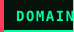</th><th width="78%">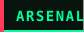</th></tr>
<tr><td><b>Offensive &amp; Web</b> recon, web app testing</td><td>

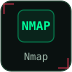
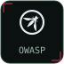
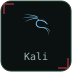
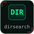
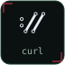
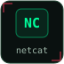
</td></tr>
<tr><td><b>Blue Team &amp; SOC</b> detection, triage, IR</td><td>
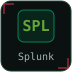

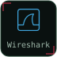
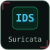

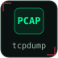
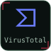
</td></tr>
<tr><td><b>Reversing &amp; Crypto</b> binaries, ciphers, forensics</td><td>
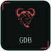
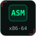
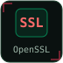
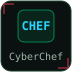
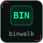
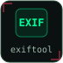
</td></tr>
<tr><td><b>Systems &amp; Networks</b> Linux, Cisco, protocols</td><td>

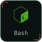
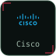

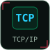
</td></tr>
<tr><td><b>Code</b> scripting and building</td><td>
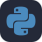
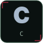

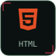
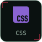
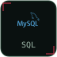
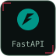
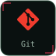
</td></tr>
<tr><td><b>AI x Security</b> agents and their attack surface</td><td>

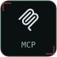
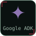
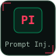
</td></tr>
</table>

## Featured Work

<table>
<tr><th width="20%">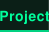</th><th width="58%">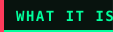</th><th width="22%">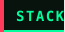</th></tr>
<tr><td><a href="https://github.com/Slimyzz/CTF-Writeups"><b>CTF Writeups</b></a></td><td>36 picoCTF and CyLab solves plus TryHackMe rooms, each written up step by step: cipher reversal, GDB stack inspection, AES decryption, web enumeration.</td><td>Python, GDB, OpenSSL, Nmap</td></tr>
<tr><td><b>Nabily</b> <i>(co-founder)</i></td><td>Student deal discovery platform for Malaysia. I own the frontend and the application security side.</td><td>TypeScript, AppSec</td></tr>
<tr><td><a href="https://github.com/Slimyzz/The-Council"><b>The Council</b></a> <i>(team of 4)</i></td><td>Google and Kaggle AI Agents capstone. Multi agent debate with MCP based fact checking.</td><td>Python, Google ADK, MCP, FastAPI</td></tr>
<tr><td><a href="https://slimyzz.github.io/"><b>Trace Node</b></a></td><td>The globe above. Shows visitors how much their public IP gives away, entirely in their browser, with nothing logged.</td><td>JavaScript, Canvas, GeoIP</td></tr>
</table>

## CTF Operations

## Certifications

  
  
  
  

## Activity

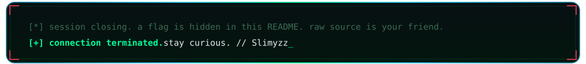
